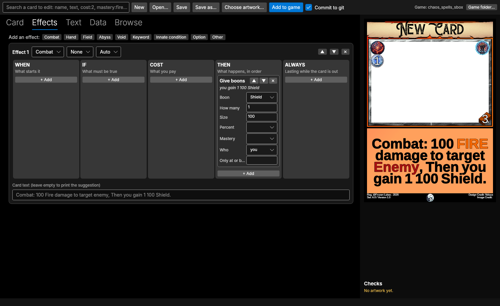
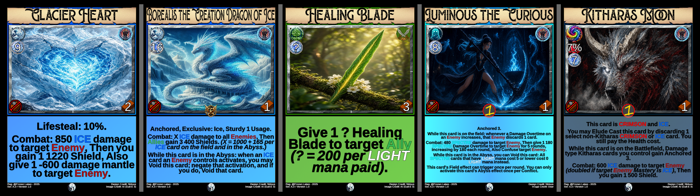

# CS Card Crafter

Created by [Niduus](https://github.com/Niduus). A card maker for **Chaos Spells**, the way
[YGO Card Crafter](https://github.com/Niduus/ygo-card-crafter) is one for YGO Omega: fill in the card, build its
effects from blocks on an event sheet, and watch the card face and its text update as you go. It saves real
`.cscard` files and installs them straight into the game.

## Download

Get `CSCardCrafter.exe` from the [Releases](../../releases) page. It is one file and needs nothing installed.
On first run, click **Game folder…** and pick your `chaos_spells_sbox` folder: the crafter reads the cards, art and
icons from there and installs new cards into it.

## Building from source

1. Clone with the game inside it: `git clone --recursive https://github.com/Niduus/cs-card-crafter`
   (or `git submodule update --init` in an existing clone).
2. Run it: `dotnet run --project src/CsCardCrafter.App` (needs the .NET 8 SDK).
3. It finds the game in `external/chaos_spells_sbox`. Use **Game folder…** to point it at your own
   `chaos_spells_sbox` checkout instead, so **Add to game** writes into the project you open in s&box.

## Adding cards to the game

**Add to game** makes the card an official game card, with nothing to move by hand:

- the card file goes in its collection folder beside the game's own cards, `Assets/cards/<collection>/<name>.cscard`
  (by Mastery, or `spirit`, `quickcast`, `fusion`, `series`);
- a new card gets the next free card ID (regular cards count up from the highest; Spirit and Fusion cards use 10000+);
- its artwork is copied into `Assets/cards/art`;
- the project's export list is checked for `cards/*` (and put back if the editor lost it);
- with **Commit to git** ticked, the card and its art are committed in the game folder, ready to push.

A card opened from the game (the card picker, or Browse, **Open to edit**) is written back where it is, keeping its ID.

## Editing the game's cards

The card picker at the top left lists every card file in the game's `Assets/cards` folder, every collection, in the game's order. Pick one (or type the first letters of its name) and it opens for editing; **Save** writes it back to its own file. If the card you're leaving has unsaved changes, the crafter asks first. Opening a card never changes it: only your edits do.

## How it works

| Tab | What it does |
| --- | --- |
| **Card** | Name, Mastery (and Duo Masteries), card type, deck, copy limit, up to 3 costs, Combat value and target, Blade / Mantle / Shield / Trap values, Lifesteal, Spirit points and uses, Anchored, keywords, series, face marks (only one, no reshuffle, fusion), artwork and credits. Picking a Mastery or type sets the background, crest and icons the game uses for it. |
| **Effects** | One row per effect: where it works (Hand, Field, Combat, Abyss, Void...), how often (once per turn, round or Conflict), and five columns, **WHEN**, **IF**, **COST**, **THEN**, **ALWAYS**. **+ Add** lists the game's own blocks for that column; fill in their blanks in place. |
| **Text** | The printed text, one `{BEG}…{END}` paragraph per effect. With auto text on, it is written from the blocks in Chaos Spells wording (oracle.md): "Combat: 650 Storm damage to target enemy, Then you gain 2 250 damage Blades." Text you type yourself always wins. The keyword panel explains every keyword on the card. |
| **Data** | The `.cscard` file exactly as it will be saved. |
| **Browse** | Every card in the game, sorted by Mastery, Mana Count, then A to Z, with one search bar. **Open to edit** edits a game card in place; **New card from this one** starts from a copy. The Blocks column shows how many of a card's effects already run on blocks in the game. |

**Innate conditions.** "Activate only if this card has 1 or more Spirit activations": add an **Innate condition**
on the Effects tab and put IF blocks in it. When they don't hold, the card can't be activated. It prints first on
the card.

The card face on the right is drawn with the game's own layout, fonts and art. The **Checks** list under it warns
about anything that would keep the card out of play (no ID, dev card, Spirit points, unknown blocks...).

## One source of truth

The crafter doesn't keep its own copy of the rules. `external/chaos_spells_sbox` is the game repo (a git
submodule on its `dev` branch), and `CsCardCrafter.Core` compiles the game's `Code/Cards`, `Code/Rules`,
`Code/Board` and `Code/Decks/DeckList.cs` straight from it, as the game's own `tools/CoreChecks` does. So the
blocks, their names and sentences, the card text colours, keywords and sort order are always the game's. When the
game gets a new block, update the submodule and it shows up in the **+ Add** menus.

## Projects

| Path | What it is |
| --- | --- |
| `src/CsCardCrafter.Core` | No UI: the game's code, card files (`CardFile`, `GameFolder`), text writing (`OracleText`, `EffectWriter`, `CardWriter`) and `CardChecks`. |
| `src/CsCardCrafter.App` | The Avalonia app. `CardFaceView` draws the card face. |
| `tests/CsCardCrafter.Tests` | `dotnet test`: every game card round-trips unchanged, oracle wording, install. |
| `.github/workflows/release.yml` | Pushing a `v*` tag builds the exe and publishes a GitHub Release (needs a `GAME_REPO_TOKEN` secret that can read the game repo). |
| `tools/Screenshots` | Renders the app without a screen into PNGs (`docs/screenshots`). |
